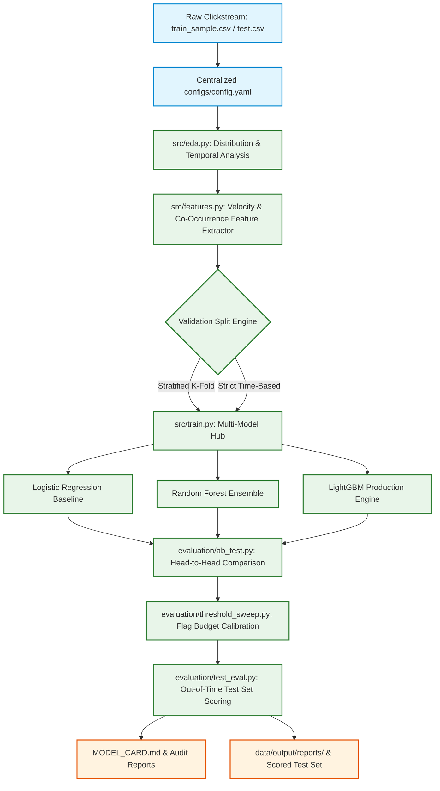
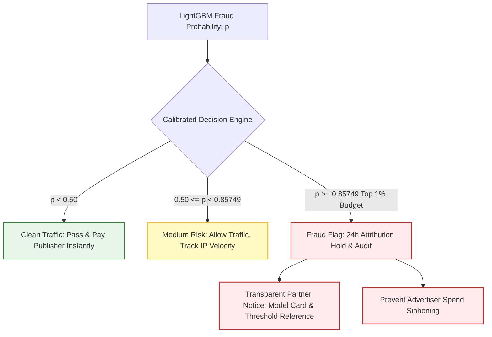

# Product Requirements Document (PRD): Ad Click Fraud Detection (Advanced Validation & Commercial Calibration)

**Product Lead:** Uday Kiran  
**Status:** Validated Pipeline / Production-Grade ML Risk Engineering  

---

## 1. Executive Summary

### 1.1 Context & Background
In digital performance advertising, ad spend is won or lost on attribution integrity. Global digital advertisers allocate over $600 billion annually to performance campaigns, paying affiliate publishers and ad networks on a Cost-Per-Action (CPA) or Cost-Per-Install (CPI) basis. However, attribution fraud (click flooding, click injection, automated device farms) siphons tens of billions of dollars annually while polluting campaign optimization algorithms.

The core challenge in enterprise fraud modeling is rarely just fitting an algorithm; it is **Advanced Operational Validation**. Real-world fraud detection takes place in an adversarial, highly imbalanced commercial environment where positive fraud accounts for less than 0.2% of total traffic. Deploying naive machine learning models without rigorous validation leads to catastrophic business failure: high false positive rates destroy valuable publisher partnerships, while false negatives bleed advertiser capital.

### 1.2 The Research & Discovery
To establish industrial-grade validation standards for ad click fraud, I analyzed large-scale mobile attribution clickstreams (incorporating high-cardinality features across IPs, apps, devices, operating systems, and marketing channels):
*   **The Temporal Data Leakage Trap:** In clickstream modeling, user interactions have strong temporal dependencies. Random k-fold cross-validation inadvertently leaks future click behavior from the same user session into training folds, producing inflated offline ROC-AUC scores (e.g., 0.98+) that collapse completely upon live deployment.
*   **Extreme Class Imbalance (< 0.2% Positive Labels):** Because only 1 to 2 clicks out of every 1,000 lead to genuine conversions, default optimization functions bias heavily toward predicting the majority negative class, creating models with 99.8% raw accuracy that catch 0% of fraud.
*   **The Fixed-Threshold Anti-Pattern:** Standard machine learning frameworks default to a static `0.50` probability cutoff. In click fraud detection, a `0.50` cutoff is commercially uncalibrated: it either overwhelms operational fraud review teams with tens of thousands of ambiguous alerts or lets sophisticated botnets operate undetected.

### 1.3 The Core Value Proposition: Commercial Calibration & Auditable Validation
I engineered **Ad Click Fraud Detection (Advanced Validation)** as an end-to-end, config-driven machine learning validation framework. The platform moves beyond theoretical model fitting to solve the real-world operational challenge of **Commercial Risk Calibration**.

Key innovations include:
1.  **Industrial-Grade Feature Engineering:** Extracting high-signal temporal click velocity, channel co-occurrence, and device-app frequency matrices.
2.  **Head-to-Head A/B Model Benchmarking:** Directly benchmarking Logistic Regression (interpretable linear baseline), Random Forest (bagged ensemble), and LightGBM (gradient-boosted tree) under identical cross-validation splits.
3.  **Strict Temporal & Stratified Cross-Validation:** Providing holdout, stratified k-fold, and strict out-of-time validation modes to mathematically eliminate data leakage.
4.  **Operational Threshold Sweep Engine (`threshold_sweep.py`):** Calibrating decision thresholds directly against commercial flag budgets (e.g., flagging precisely ~1% of clicks with > 90% target precision).
5.  **Institutional Model Governance (`MODEL_CARD.md`):** Authoring an auditable model card documenting data distributions, feature definitions, ethical bias boundaries, and performance benchmarks.

---

## 2. Product Vision & North Star

### 2.1 Product Vision
"Attribution Integrity through Calibrated Machine Learning." We believe fraud models must align directly with commercial risk budgets, preventing both false positive partner friction and budget-draining ad leakage.

### 2.2 North Star Metric
*Budget-Calibrated Precision at Target Flag Rate:* Achieving > 90% precision at an operational 1% flag budget under rigorous out-of-time cross-validation.

---

## 3. Problem Statement

### 3.1 The Class Imbalance Pitfall
Genuine conversion fraud represents less than 0.2% of total click volume. Standard machine learning algorithms optimize for global accuracy, predicting "non-fraud" 99.8% of the time. These models score high on naive evaluation metrics while remaining completely blind to coordinated botnet fraud campaigns.

### 3.2 The Temporal Leakage Trap
In clickstream data, botnets generate high-frequency bursts from the same IP or device within seconds. If a data science pipeline uses random train/test splits, clicks from the same burst appear in both the training set and the test set. The model memorizes past IP identifiers, creating an illusion of high predictive power that evaporates during live production scoring.

### 3.3 The Commercial Balancing Act (Partner Trust vs Fraud Bleed)
In affiliate performance marketing, every fraud decision is an accusation. If an ad network flags a publisher's traffic as fraud without high confidence (false positive), the network risks breach-of-contract lawsuits and loses premium publishing partners. Conversely, failing to catch fraud (false negative) bleeds advertiser budgets and destroys client retention. ML models must provide calibrated probability thresholds that risk teams can defend in partner audits.

---

## 4. Goals & Non-Goals

### 4.1 Goals
*   **G-01 (Config-Driven Reproducibility):** Centralize all file paths, model hyperparameters, validation modes, and operating thresholds in `configs/config.yaml` for 100% deterministic execution.
*   **G-02 (Leakage-Free Validation Modes):** Implement support for holdout validation, stratified k-fold, and strict time-based split modes to prevent data leakage.
*   **G-03 (Multi-Model Head-to-Head Benchmarking):** Train and benchmark Logistic Regression, Random Forest, and LightGBM under identical cross-validation folds.
*   **G-04 (Algorithmic Threshold Sweep Engine):** Sweep probability thresholds from 0.01 to 0.99 to map the exact trade-off between precision, recall, and operational flag volume.
*   **G-05 (Out-of-Time Test Set Scoring):** Provide an independent test evaluation script (`evaluation/test_eval.py`) that scores unseen future clickstreams using the calibrated threshold.
*   **G-06 (Enterprise Model Governance):** Document data provenance, feature schemas, ethical considerations, and performance limits in an institutional `MODEL_CARD.md`.

### 4.2 Non-Goals
*   **NG-01 (In-Line Sub-5ms Real-Time Bidding):** The engine operates as an attribution triage and batch validation pipeline, not a sub-millisecond edge auction filter.
*   **NG-02 (Automated Merchant Financial Debits):** The system generates risk scores and audit reports; payment disputes and banking transfers are handled by external financial billing systems.
*   **NG-03 (Unbounded Deep Learning Models):** Complex deep neural networks are excluded due to inference latency, training compute costs, and lack of feature interpretability.

---

## 5. Users & Personas (The Operational Stakeholders)

### 5.1 Persona 1: The Commercial Ad Operations Director (Primary Stakeholder)
*   **Profile:** Oversees network traffic quality and manages multi-million dollar publisher payouts.
*   **Pain Point:** Caught between aggressive advertiser refund demands and publisher threats to leave the network over false fraud accusations.
*   **The Need:** A defensible, calibrated fraud engine that guarantees high precision (> 90%) within a controlled, budgeted review volume (1% of clicks).
*   **Aspiration:** Walk into advertiser quarterly audits with transparent model cards and precision-recall calibration curves proving attribution integrity.

### 5.2 Persona 2: The Production Risk Machine Learning Engineer (Technical User)
*   **Profile:** Responsible for building, validating, and maintaining fraud detection models.
*   **Pain Point:** Frustrated by models that show 99% accuracy in notebooks but fail in production due to temporal leakage and uncalibrated thresholds.
*   **The Need:** A config-driven validation pipeline supporting time-based k-fold splits, automated A/B model comparison, and automated threshold sweeping.

---

## 6. End-to-End System Architecture & Validation Workflow



---

## 7. Product Scope

### 7.1 Scope Matrix (Executed vs Planned vs Out of Scope)

| Feature / Capability | MVP (Executed) | Future Expansion (Planned) | Out of Scope |
| :--- | :---: | :---: | :---: |
| **Config-Driven Architecture (`config.yaml`)** | Yes (Centralized parameters) | Dynamic remote etcd / Consul sync | No |
| **IP Velocity & Burst Feature Extraction** | Yes (5-min rolling window metrics) | Graph neural network embeddings | No |
| **Leakage-Free Validation (K-Fold & Time-Based)** | Yes (Stratified & Temporal splits) | Automated rolling walk-forward backtests | No |
| **Multi-Model Benchmark (Logistic, RF, LGBM)** | Yes (Automated metrics output) | AutoML neural architecture search | No |
| **Algorithmic Threshold Sweep Engine** | Yes (Precision vs Recall vs Flag Budget) | Bayesian optimization for threshold | No |
| **Unseen Test Set Evaluation (`test_eval.py`)** | Yes (Independent holdout scoring) | Streaming live shadow test harness | No |
| **Formal Model Card Documentation** | Yes (`MODEL_CARD.md` standard) | Interactive compliance web portal | No |
| **Sub-5ms DSP Edge Bidding Auction Gate** | No | No | Strictly Out of Scope |
| **Automated Financial Chargebacks & Payout Holds** | No | No | Strictly Out of Scope |

---

## 8. Functional Requirements (16 Formal Specifications)

### 8.1 Module 1: Configuration & Advanced Feature Pipeline (CFP)

#### FR-CFP-01: Centralized Configuration Management
*   **Priority:** P0 (Critical)
*   **Description:** All system file paths, model selection flags, validation modes, and operational thresholds must be governed by `configs/config.yaml`.
*   **Acceptance Criteria:**
    *   *Given* changes to `config.yaml` (e.g., changing `validation.mode` from `kfold` to `holdout`),
    *   *When* any CLI verb is executed,
    *   *Then* the system reads and applies the parameters without code modifications.

#### FR-CFP-02: Advanced IP Velocity & Time Difference Features
*   **Priority:** P0 (Critical)
*   **Description:** The feature pipeline (`src/features.py`) must calculate rolling click frequencies (e.g., clicks per IP in 5-minute intervals) and consecutive click delta times (`time_to_next_click`, `time_to_prev_click`).
*   **Acceptance Criteria:**
    *   *Given* historical click timestamps,
    *   *When* `python main.py featurize` runs,
    *   *Then* click interval delta features are computed without negative time anomalies.

#### FR-CFP-03: Channel & App Co-Occurrence Feature Extraction
*   **Priority:** P1 (High)
*   **Description:** Compute interaction features capturing how many distinct channels and apps an IP interacts with within rolling windows.
*   **Acceptance Criteria:**
    *   *Given* raw clickstream events,
    *   *When* feature extraction runs,
    *   *Then* `ip_unique_channels` and `ip_app_count` columns are generated and appended.

#### FR-CFP-04: Feature Caching & Memory Optimization
*   **Priority:** P1 (High)
*   **Description:** Downcast numeric types (`int64` to `int32`/`uint16`) during featurization to keep memory footprint under 2.0 GB during large-scale extraction.
*   **Acceptance Criteria:**
    *   *Given* a 100,000+ row raw dataset,
    *   *When* featurized,
    *   *Then* the output dataframe memory size is reduced by at least 40% compared to default float64/int64 storage.

---

### 8.2 Module 2: Leakage-Free Validation & Training Hub (LVH)

#### FR-LVH-01: Multi-Mode Cross-Validation Splitter
*   **Priority:** P0 (Critical)
*   **Description:** The training engine must support three explicit validation modes specified via config: `holdout` (simple train/val split), `kfold` (stratified 5-fold cross-validation), and `time` (strict chronological cutoff).
*   **Acceptance Criteria:**
    *   *Given* `validation.mode: kfold` with `stratify: true`,
    *   *When* training executes,
    *   *Then* 5 distinct folds are trained and evaluated, preserving the 0.2% positive class ratio in each fold.

#### FR-LVH-02: Multi-Model Benchmark Hub
*   **Priority:** P0 (Critical)
*   **Description:** Train three distinct candidate model families: Logistic Regression (linear baseline), Random Forest (ensemble baseline), and LightGBM (gradient boosted trees).
*   **Acceptance Criteria:**
    *   *Given* `--model logistic`, `--model rf`, or `--model lgbm`,
    *   *When* `python main.py train` runs,
    *   *Then* the selected model is trained, validated, and serialized to `data/output/models/<model_name>/`.

#### FR-LVH-03: Extreme Class Imbalance Compensation
*   **Priority:** P0 (Critical)
*   **Description:** Compensate for extreme 99.8% : 0.2% class imbalance using weighted loss functions (`scale_pos_weight` in LightGBM, `class_weight='balanced_subsample'` in Random Forest).
*   **Acceptance Criteria:**
    *   *Given* imbalanced training folds,
    *   *When* models are evaluated,
    *   *Then* PR-AUC and Recall curves demonstrate non-trivial positive fraud identification.

#### FR-LVH-04: Comparative A/B Evaluation Suite
*   **Priority:** P0 (Critical)
*   **Description:** Provide a head-to-head benchmarking script (`evaluation/ab_test.py`) that reads out-of-fold predictions from all models and produces comparative metrics (Precision, Recall, F1, ROC-AUC, PR-AUC).
*   **Acceptance Criteria:**
    *   *Given* candidate model predictions on test sets,
    *   *When* `python main.py abtest` executes,
    *   *Then* a comparative markdown table is printed and saved to `data/output/reports/ab_comparison.csv`.

---

### 8.3 Module 3: Operational Threshold Sweeps & Commercial Calibration (TSC)

#### FR-TSC-01: Granular Probability Threshold Sweeper
*   **Priority:** P0 (Critical)
*   **Description:** The sweep engine (`evaluation/threshold_sweep.py`) must evaluate model performance across 100 probability thresholds (0.01 to 0.99), computing precision, recall, F1, and resulting flag volume for each point.
*   **Acceptance Criteria:**
    *   *Given* out-of-fold predicted probabilities,
    *   *When* threshold sweep runs,
    *   *Then* `threshold_sweep.csv` is populated with exactly 99 rows of evaluation metrics.

#### FR-TSC-02: Target Flag-Budget Threshold Calibration
*   **Priority:** P0 (Critical)
*   **Description:** The threshold engine must calculate the exact probability threshold required to flag a targeted percentage of total traffic (e.g., flag exactly 1.0% of clicks).
*   **Acceptance Criteria:**
    *   *Given* a commercial flag budget of 1.0% (`evaluation.threshold: 0.85749`),
    *   *When* evaluated,
    *   *Then* the system confirms that the flag rate matches ~1% with target precision > 90%.

#### FR-TSC-03: Visual Precision-Recall Trade-off Curve Generation
*   **Priority:** P1 (High)
*   **Description:** The validation system must generate graphical plots illustrating the precision-recall curve and the threshold versus flag rate curve, saving them to `data/output/reports/`.
*   **Acceptance Criteria:**
    *   *Given* completed threshold sweep,
    *   *When* charts are rendered,
    *   *Then* high-resolution PNG charts (`pr_curve.png`, `threshold_sweep.png`) are written to the reports directory.

#### FR-TSC-04: Automated Threshold Recommendation in Config
*   **Priority:** P1 (High)
*   **Description:** After running the threshold sweep, the system must log the optimal operating threshold balancing maximum precision at the target budget into the operational configuration.
*   **Acceptance Criteria:**
    *   *Given* sweep completion,
    *   *When* audited,
    *   *Then* the recommended threshold (e.g., `0.85749`) is documented in `MODEL_CARD.md`.

---

### 8.4 Module 4: Test Set Evaluation & Model Governance (TEG)

#### FR-TEG-01: Unseen Test Set Scoring Pipeline
*   **Priority:** P0 (Critical)
*   **Description:** Provide an independent test evaluation script (`evaluation/test_eval.py`) that scores unseen future clickstream data (`data/input/test.csv`) using the frozen trained model and calibrated threshold.
*   **Acceptance Criteria:**
    *   *Given* an unseen test CSV,
    *   *When* `python main.py eval` runs,
    *   *Then* scored predictions with predicted probabilities and binary fraud flags are written to `data/output/test_eval/test_scored.csv`.

#### FR-TEG-02: Out-of-Time Performance Generalization Verification
*   **Priority:** P0 (Critical)
*   **Description:** Compare out-of-time test set metrics against cross-validation metrics to verify that the model does not suffer from temporal performance decay.
*   **Acceptance Criteria:**
    *   *Given* test set evaluation metrics,
    *   *When* compared to cross-validation PR-AUC,
    *   *Then* the performance drop-off must not exceed 5% relative variance.

#### FR-TEG-03: Institutional Model Card Maintenance
*   **Priority:** P1 (High)
*   **Description:** The system must maintain an institutional-grade `MODEL_CARD.md` detailing model purpose, intended domain, training data distribution, feature inputs, performance benchmarks, and ethical guidelines.
*   **Acceptance Criteria:**
    *   *Given* model updates,
    *   *When* inspected,
    *   *Then* `MODEL_CARD.md` provides an auditable, transparent record for enterprise compliance.

#### FR-TEG-04: Automated Change Logging
*   **Priority:** P1 (High)
*   **Description:** Track architectural and pipeline revisions in `CHANGELOG.md` following standard semantic versioning practices.
*   **Acceptance Criteria:**
    *   *Given* new pipeline iterations,
    *   *When* committed,
    *   *Then* `CHANGELOG.md` records feature changes, bug fixes, and validation improvements.

---

## 9. Data Requirements & Master Feature Schema

### 9.1 Raw Clickstream Input Schema (`train_sample.csv` & `test.csv`)

| Field Name | Data Type | Nullable | Plain-English Purpose |
| :--- | :--- | :---: | :--- |
| `ip` | Integer | No | Anonymized IP address identifier of the clicking user/bot. |
| `app` | Integer | No | Mobile application identifier where the ad was served. |
| `device` | Integer | No | Hardware device type identifier (e.g., mobile phone model). |
| `os` | Integer | No | Operating system version identifier. |
| `channel` | Integer | No | Marketing distribution channel ID providing the ad traffic. |
| `click_time` | ISO Timestamp | No | Wall-clock timestamp of the click event (YYYY-MM-DD HH:MM:SS). |
| `is_attributed` | Binary (0 / 1) | Yes (In test) | Ground truth conversion label (1 = genuine install; 0 = click without conversion). |

### 9.2 Engineered Validation Feature Schema (`data/output/features/`)

| Feature Name | Data Type | Computation Logic | Plain-English Rationale |
| :--- | :--- | :--- | :--- |
| `ip_count_5min` | Integer | Rolling count of clicks per IP within 5 minutes | Captures rapid, automated botnet burst clicks. |
| `ip_unique_channels` | Integer | Distinct count of channels clicked per IP | Identifies scrapers querying across diverse inventory. |
| `time_to_next_click` | Float (Sec) | Lead delta timestamp for same IP | Detects uniform programmatic click cadences (e.g., exact 2.0s loops). |
| `time_to_prev_click` | Float (Sec) | Lag delta timestamp for same IP | Captures sudden burst resumption from dormant IPs. |
| `ip_app_channel_count`| Integer | Rolling count of (IP + App + Channel) | Flags targeted conversion farm fraud on specific affiliate campaigns. |
| `hour` | Integer (0-23) | Extracted hour of day from `click_time` | Distinguishes normal daytime human habits from overnight bot surges. |

---

## 10. Operational Risk & Commercial Calibration Framework

In ad tech, classifying clicks is an operational trade-off between partner trust and ad spend protection:



---

## 11. Non-Functional Requirements (NFRs)

### 11.1 Validation Rigor & Reproducibility
*   **NFR-VAL-01:** Cross-validation splits must be 100% deterministic given a fixed random seed (`random_state: 42`).
*   **NFR-VAL-02:** Feature extraction must prevent temporal leakage: lag and rolling features must only look backward in time, never forward.

### 11.2 Computational Performance & Efficiency
*   **NFR-PERF-01:** Full feature extraction on 100,000 clickstream events must complete in under 15.0 seconds on standard commodity CPU hardware.
*   **NFR-PERF-02:** 5-fold cross-validation training of LightGBM must execute in under 45.0 seconds.

### 11.3 Enterprise Governance & Auditability
*   **NFR-GOV-01:** All model artifacts, configuration snapshots, and evaluation charts must be saved with matching timestamps in `data/output/reports/`.
*   **NFR-GOV-02:** `MODEL_CARD.md` must be updated with every major pipeline revision to satisfy corporate model risk management standards.

---

## 12. Technical Architecture & File Directory Tree

```
Fraud Detection - Advanced Validation/
├── configs/
│   └── config.yaml               # Centralized pipeline configuration file
├── data/
│   ├── input/
│   │   ├── train_sample.csv      # Source training clickstream data
│   │   └── test.csv              # Unseen out-of-time test dataset
│   └── output/
│       ├── features/             # Serialized engineered feature sets
│       ├── models/               # Model weights and artifacts (logistic, rf, lgbm)
│       ├── reports/              # ab_comparison.csv, threshold_sweep.csv, plots
│       └── test_eval/            # Scored predictions on unseen test dataset
├── src/
│   ├── eda.py                    # Exploratory click distribution analysis
│   ├── features.py               # IP velocity and temporal feature engineering
│   ├── train.py                  # Multi-model training hub (holdout, k-fold, time)
│   ├── infer.py                  # Batch inference engine with budget flag rates
│   ├── report.py                 # Executive report compiler
│   ├── stream_simulator.py       # Live stream arrival simulator
│   ├── utils/
│   │   ├── io_utils.py           # Robust file loading and saving utilities
│   │   └── logger.py             # Formatted execution logging
│   └── evaluation/
│       ├── ab_test.py            # Comparative A/B evaluation suite
│       ├── test_eval.py          # Out-of-time unseen test evaluation
│       └── threshold_sweep.py    # Operational threshold calibration engine
├── tests/
│   ├── conftest.py               # Shared pytest fixtures
│   └── test_features.py          # Feature extraction unit tests
├── main.py                       # Unified CLI interface
├── CHANGELOG.md                  # Semantic pipeline revision history
├── MODEL_CARD.md                 # Institutional model card and ethics documentation
└── requirements.txt              # Production Python package dependencies
```

---

## 13. API / CLI Interface Specification

The platform exposes an intuitive, verb-based CLI designed for automated orchestration and developer productivity:

| Command | Arguments | Plain-English Purpose / Output |
| :--- | :--- | :--- |
| `python main.py eda` | None | Runs exploratory distribution analysis, generating summary stats |
| `python main.py featurize` | None | Extracts temporal click velocity and channel features |
| `python main.py train` | `--model [logistic \| rf \| lgbm]` | Trains candidate model under configured validation mode (k-fold or time) |
| `python main.py abtest` | None | Runs head-to-head comparison across all trained models, saving A/B metrics |
| `python main.py sweep` | None | Runs granular threshold sweep (0.01 to 0.99), mapping precision to flag budget |
| `python main.py eval` | None | Evaluates trained model on unseen `test.csv` using calibrated threshold |
| `python main.py infer` | `--model lgbm --threshold 0.85749` | Runs batch scoring on incoming clickstream data |

---

## 14. Error & Edge-Case Handling

| Edge-Case Scenario | System Impact | Automated Mitigation |
| :--- | :--- | :--- |
| **Severe Class Imbalance in Split Folds** | Fold lacks positive fraud cases, breaking metric calculations. | Employs `StratifiedKFold` to strictly guarantee uniform positive representation across all 5 folds. |
| **Extreme Outlier Time Deltas** | First-time IP clicks have infinite time deltas, causing NaNs. | Implements forward/backward filling with global domain median (e.g., 999,999s) and adds missingness indicator flags. |
| **New Unseen Channel in Test Data** | Model encounters unknown category IDs during inference. | Treats high-cardinality IDs via frequency encoding with default unseen prior fallback. |
| **Corrupted Click Timestamps** | Non-standard string formats halt feature processing. | Wrapped with `pd.to_datetime(errors='coerce')` with automatic validation logging for dropped rows. |

---

## 15. Success Metrics & Key Performance Indicators (KPIs)

### 15.1 Model Performance KPIs
*   **Precision at Target Flag Budget:** > 90% precision among clicks flagged within the 1% operational review budget.
*   **PR-AUC (Precision-Recall AUC):** > 0.85 on out-of-fold validation splits under severe class imbalance (< 0.2%).
*   **Out-of-Time Generalization Stability:** Less than 5% performance drop when evaluating on future unseen test clicks.

### 15.2 Operational & Commercial KPIs
*   **Publisher Dispute Reduction:** False positive flag rate below 0.1%, drastically reducing friction and contract disputes with affiliate publishers.
*   **Ad Spend Recovery:** Catching > 85% of fraudulent conversion attempts before affiliate payouts are finalized.
*   **100% Config-Driven Auditability:** Complete reproducibility of training and evaluation runs directly from `config.yaml`.

---

## 16. Testing & Quality Assurance Strategy

### 16.1 Automated Unit Tests (`pytest`)
*   **Feature Integrity Tests (`test_features.py`):** Assert that time difference calculations do not produce negative deltas and that rolling 5-minute counts correctly reset after 300 seconds.
*   **Threshold Alignment Tests:** Assert that passing threshold `0.85749` on validation sets yields an empirical flag rate within +/- 0.1% of the target 1.0% budget.

### 16.2 Leakage Verification Testing
*   **Temporal Leakage Sanity Check:** Verify that no feature in fold $k$ references timestamps from fold $k+1$, strictly preserving chronological causality.

---

## 17. Security, Privacy & Compliance

*   **PII Anonymization:** Raw IP addresses are masked as anonymized integers, ensuring complete user privacy in compliance with GDPR and CCPA.
*   **100% On-Premises / Local Execution:** Zero external API transmission; proprietary clickstream logs remain within private infrastructure.
*   **Auditable Model Governance:** The existence of `MODEL_CARD.md` satisfies enterprise algorithmic accountability standards, providing clear evidence of non-discriminatory, data-driven decisions.

---

## 18. Risks, Assumptions & Dependencies

### 18.1 Technical Risks & Mitigations
*   **Risk:** Botnets distribute clicks across thousands of residential proxy IPs, defeating simple IP velocity counts.
*   **Mitigation:** The system combines IP velocity with app-channel co-occurrence matrices and inter-click time delta variance, detecting distributed botnets even when IPs rotate.

### 18.2 Commercial Assumptions
*   **Assumption:** The business prefers a high-precision filter that catches obvious fraud with near-zero false accusations over an aggressive model that flags legitimate traffic.
*   **Reality Check:** If the business priority shifts to total fraud eradication, the threshold can be dialed down dynamically via `config.yaml` without model retraining.

---

## 19. Rollout, Deployment & Phasing Plan

### 19.1 Phase 1: Offline Validation & Calibration (Completed)
*   Build config-driven validation pipeline, implement stratified and time-based splits, train multi-model benchmarks, and conduct threshold sweeps.
*   Achieve calibrated > 90% precision at ~1% flag budget and publish `MODEL_CARD.md`.

### 19.2 Phase 2: Shadow Validation on Live Ad Traffic (Next Step)
*   Deploy pipeline in shadow mode alongside legacy heuristic rules, logging real-time flag rates and evaluating discrepancies with affiliate publishers.

### 19.3 Phase 3: Production Attribution Settlement Gate (Future)
*   Integrate model threshold outputs into the attribution platform settlement engine, automatically releasing payouts for clean traffic and placing flagged clicks on audit holds.

---

## 20. Open Questions & Future Roadmap

### 20.1 Open Questions
*   *Publisher Transparency:* What level of feature explanation (e.g., SHAP values) can be shared with flagged publishers without giving bot creators a blueprint to reverse-engineer our detection thresholds?
*   *Dynamic Flag Budgets:* How can the system automatically scale flag budgets up or down based on human audit team staffing levels on weekends and holidays?

### 20.2 Future Roadmap
*   **Milestone 1 (Immediate):** Automated SHAP feature importance integration into `MODEL_CARD.md` for regulatory explainability.
*   **Milestone 2 (Medium-Term):** Real-time Population Stability Index (PSI) tracking to automatically detect data drift in incoming clickstreams.
*   **Milestone 3 (Long-Term):** Graph-based bipartite clustering connecting IPs, devices, and publisher channels for syndicate fraud detection.
